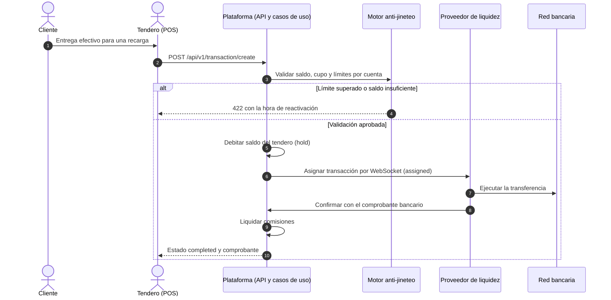

# Plataforma de corresponsalía bancaria (Laravel)

[](https://github.com/KevinAndrey96/laravel-fintech-correspondent-banking-platform/actions/workflows/ci.yml)


Plataforma de corresponsalía bancaria para redes de comercios de barrio (misceláneas, droguerías, papelerías y minimercados). Permite a los tenderos recibir efectivo y procesar recargas, depósitos, retiros y pagos de facturas hacia billeteras y bancos como **Nequi**, **Daviplata**, **Bancolombia** y **Banco de Bogotá**, con liquidación automática de comisiones por niveles y control de límites por cuenta (*anti-jineteo*).

Proyecto desarrollado para un cliente. El repositorio se publica como muestra de portafolio.

## Funcionalidades

- **Jerarquía de actores**: administrador, distribuidor, tendero, proveedor de liquidez y perfil de saldos, con permisos granulares administrados desde la propia plataforma (Spatie Permission).
- **Comisiones por niveles**: cada transacción completada liquida la comisión del tendero, del distribuidor, del proveedor y de la plataforma.
- **Límites anti-jineteo**: ventanas de tiempo y número máximo de transacciones por cuenta destino configurables por producto, con aviso de la hora de reactivación.
- **Tiempo real**: los cambios de estado (`hold`, `assigned`, `completed`, `cancelled`) se notifican por WebSockets (`beyondcode/laravel-websockets`) y por webhook a los comercios en modo desarrollador.
- **Seguridad de acceso**: doble factor con Google Authenticator, contraseña diaria, bloqueo global de la plataforma y suplantación auditada de usuarios.
- **Saldos auditables**: cada movimiento queda registrado con saldo anterior y saldo resultante; reportes exportables a Excel.
- **API REST para POS**: autenticación con Laravel Passport y documentación OpenAPI en `/api/documentation`.

## Flujo de una transacción



## Arquitectura

```text
app/
├── DTOs/            # Objetos de transferencia para las solicitudes
├── Enums/           # Estados de transacción, roles y tipos de producto
├── Events/          # Eventos emitidos por WebSockets
├── Exports/         # Reportes de transacciones, saldos y ganancias
├── Http/
│   ├── Controllers/ # Controladores delgados que delegan en casos de uso
│   └── Middleware/  # 2FA, contraseña diaria, bloqueo de plataforma y autorización
├── Models/          # Modelos Eloquent
├── Repositories/    # Persistencia detrás de contratos
└── UseCases/        # Lógica de negocio (transacciones, límites, estadísticas, roles)
```

## API

| Método | Ruta | Descripción |
|:--|:--|:--|
| `POST` | `/api/v1/user/login` | Autentica una terminal en modo desarrollador y devuelve un token Bearer |
| `GET` | `/api/v1/products` | Productos y convenios asignados al comercio |
| `POST` | `/api/v1/transaction/create` | Crea una transacción con validación de límites |
| `GET` | `/api/v1/transaction/detail/{id}` | Estado, comprobante y comisiones de una transacción |
| `GET` | `/api/v1/transactions/user` | Historial paginado del comercio autenticado |

## Desarrollo local

Requisitos: Docker con Compose v2, o PHP 8.1+, Composer y MySQL 8.

```bash
cp .env.example .env
make up        # Nginx en http://localhost:8000, PHP-FPM, MySQL, Redis, WebSockets y Mailpit
make key
make reset-db  # Esquema y datos de demostración de database/schema.sql y seeds.sql
make seed
make help      # Resto de comandos
```

## Calidad y CI

GitHub Actions ejecuta en cada push y pull request:

- `composer validate --strict` y **Laravel Pint** (`vendor/bin/pint --test`).
- Migraciones completas sobre MySQL 8, llaves de Passport y **PHPUnit** en PHP 8.1 y 8.2: login de la API, registro público deshabilitado, rutas administrativas protegidas por sesión y permisos, y visibilidad de transacciones limitada a sus participantes.
- Validación de `docker-compose.yml` y construcción de la imagen PHP con verificación de extensiones.

```bash
vendor/bin/pint --test
vendor/bin/phpunit
```

## Licencia

Sin licencia de código abierto. Este código pertenece a un proyecto de cliente y se publica únicamente como muestra de portafolio; todos los derechos reservados.
