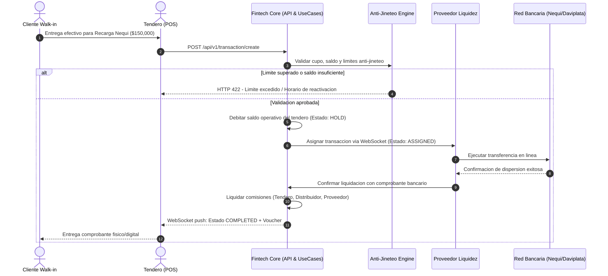

# Fintech Correspondent Banking Platform

[](https://github.com/KevinAndrey96/fintech-correspondent-banking-platform/actions/workflows/ci.yml)
[](https://www.php.net/)
[](https://laravel.com/)
[](https://www.mysql.com/)
[](https://redis.io/)
[](https://www.docker.com/)
[](LICENSE)

A high-concurrency Fintech and Correspondent Banking (*Corresponsal Bancario*) platform engineered for neighborhood retail networks (miscelaneas, droguerias, papelerias, minimarkets). The platform empowers local merchants to process cash-in, cash-out, deposits, withdrawals, and utility bill payments for Colombia's primary financial ecosystems, including **Nequi**, **Daviplata**, **Bancolombia**, **Banco de Bogota**, and mobile network operators.

Built with Clean Architecture patterns (DTOs, Repositories, UseCases), real-time WebSockets event broadcasting, asynchronous liquidity routing, automated multi-tier commission splits, and a fraud prevention velocity engine (*anti-jineteo* / anti-smurfing).

---

## Key Domain Capabilities

### 1. Multi-Tier Stakeholder Hierarchy
The system coordinates four distinct operational roles with strict access controls and financial boundaries:
- **Administrator**: Platform operator managing banking agreements, commission groups, global liquidity reserves, system locks, and dispute resolution.
- **Distributor**: Regional network manager responsible for merchant onboarding, operating balance assignments, credit lines, and field operations.
- **Shopkeeper (*Tendero*)**: Frontline retail merchant operating POS/web terminals, accepting cash from walk-in customers, initiating deposits, and disbursing cash for withdrawals.
- **Supplier (*Proveedor de Liquidez*)**: Automated or supervised liquidity agents connected to banking rails, executing bulk interbank dispersals and wallet transfers.

### 2. Multi-Tier Automated Commission Engine
Every settled transaction executes real-time commission calculations split across the supply chain:
- **Shopkeeper Cut**: Immediate merchant remuneration credited upon successful transaction completion.
- **Distributor Cut**: Regional management commission credited to the parent distributor.
- **Supplier Fee**: Technical liquidity provider compensation.
- **Platform Fee**: Core gross operating margin retained by the administration.

### 3. Anti-Fraud & Velocity Engine (*Anti-Jineteo*)
Prevents structuring (smurfing) and tax avoidance loops (such as Colombia's 4x1000 financial movements tax) through configurable velocity limits:
- Sliding time windows (configurable hours per banking product).
- Maximum consecutive transaction quotas per destination account number.
- Automatic cooldown enforcement with precise time-of-clearance warnings.

### 4. Real-Time Event Dispatching & Webhooks
- **WebSockets**: Live state transitions (`hold` -> `assigned` -> `completed` / `cancelled`) pushed to shopkeeper terminals via `beyondcode/laravel-websockets`.
- **Merchant Webhooks**: Real-time HTTP POST notifications dispatched to shopkeepers operating in developer mode when transaction status updates occur.
- **Multi-Factor Authentication**: Native Google Authenticator (TOTP) 2FA integration protecting administrative and financial actions.

---

## Architecture & System Flow



---

## Clean Architecture Directory Layout

```text
app/
├── DTOs/                      # Data Transfer Objects for strict request typing
│   ├── Balances/
│   ├── Products/
│   ├── Roles/
│   └── Transactions/
├── Enums/                     # Domain enums (TransactionStatus, UserRoles, ProductTypes)
├── Events/                    # Real-time WebSockets broadcast events (SendMessage, etc.)
├── Exceptions/                # Domain-specific financial exceptions
├── Exports/                   # Excel reporting for transactions, balances, and profits
├── Http/
│   ├── Controllers/           # Thin controllers delegating to domain UseCases
│   │   ├── API/               # RESTful API endpoints for mobile/POS clients
│   │   ├── Balances/          # Balance top-up and approval workflows
│   │   ├── Products/          # Financial product catalog management
│   │   ├── Transactions/      # Transaction processing and reporting
│   │   └── Users/             # User onboarding, 2FA, daily passwords
│   └── Middleware/            # Multi-layer guards (2FA, transactions, authorization)
├── Models/                    # Eloquent domain models with relationships and casts
├── Providers/                 # Service providers and repository bindings
├── Repositories/              # Interface-driven persistence layer
│   ├── Contracts/             # Abstractions decoupling database implementations
│   ├── Balances/
│   ├── Products/
│   ├── Transactions/
│   └── Users/
└── UseCases/                  # Pure application business logic
    ├── Contracts/
    ├── Roles/
    ├── Statistics/
    └── Transactions/
        ├── CreateTransactionUseCase.php
        ├── GetAllTransactionsByUserUseCase.php
        ├── GetTransactionDetailUseCase.php
        └── ValidateLimitOfTransactionsByAccountUseCase.php
```

---

## Financial Products Catalog

| ID | Servicio Financiero | Categoria | Monto Minimo | Monto Maximo | Comision Tendero | Regla Anti-Jineteo |
|:---|:-------------------|:----------|:-------------|:-------------|:-----------------|:-------------------|
| 1  | Recarga Nequi | Billeteras Moviles | $5,000 COP | $2,000,000 COP | $450 COP | Max 3 txs / 24 horas |
| 2  | Deposito Daviplata | Billeteras Moviles | $10,000 COP | $2,000,000 COP | $500 COP | Max 3 txs / 24 horas |
| 3  | Deposito Bancolombia Ahorros | Corresponsal Bancario | $10,000 COP | $3,000,000 COP | $700 COP | Max 5 txs / 12 horas |
| 4  | Ahorro a la Mano (ALM) | Billeteras Moviles | $5,000 COP | $1,500,000 COP | $450 COP | Max 4 txs / 12 horas |
| 5  | Deposito Banco de Bogota | Corresponsal Bancario | $10,000 COP | $3,000,000 COP | $650 COP | Max 4 txs / 12 horas |
| 6  | Retiro Nequi con Pin OTP | Retiros en Efectivo | $10,000 COP | $1,000,000 COP | $900 COP | Pin temporal 6 digitos |
| 7  | Retiro Daviplata OTP | Retiros en Efectivo | $10,000 COP | $1,000,000 COP | $900 COP | Codigo OTP 6 digitos |
| 8  | Pago Factura Servicios Publicos | Recaudos y Facturas | $2,000 COP | $5,000,000 COP | $550 COP | Enel, EPM, Vanti, Acueducto |
| 9  | Recarga Celular Multidestino | Operadores Moviles | $1,000 COP | $100,000 COP | $300 COP | Claro, Tigo, Movistar, Wom |
| 10 | Giro Postal Nacional | Giros Nacionales | $10,000 COP | $2,500,000 COP | $1,000 COP | Validacion SMS + Cedula |

---

## API Documentation Summary

The platform provides RESTful API endpoints secured via Laravel Passport OAuth2 tokens for POS integrations and third-party merchant applications.

### Authentication
- `POST /api/v1/user/login`: Authenticate merchant terminal and obtain Bearer access token.

### Products & Agreements
- `GET /api/v1/products`: List active banking agreements and financial products assigned to the merchant.

### Transactions
- `POST /api/v1/transaction/create`: Initiate cash-in or withdrawal transaction with anti-jineteo validation.
- `GET /api/v1/transaction/detail/{id}`: Retrieve real-time execution state, voucher number, and commission breakdown.
- `GET /api/v1/transactions/user`: Paginated transaction history for the authenticated merchant.

Interactive Swagger/OpenAPI documentation is available at `/api/documentation` when running the application.

---

## Quickstart & Local Development

### Prerequisites
- Docker Engine 20.10+ and Docker Compose v2+
- Git

### 1. Clone & Setup Environment
```bash
git clone git@github.com-personal:KevinAndrey96/fintech-correspondent-banking-platform.git
cd fintech-correspondent-banking-platform
cp .env.example .env
```

### 2. Start Services with Docker Compose
```bash
make up
```

This launches the full multi-service topology:
- **Web Server (Nginx)**: `http://localhost:8000`
- **Application (PHP 8.1 FPM)**: Internal FastCGI container
- **Database (MySQL 8.0)**: `localhost:3306` (Database: `fintech_correspondents`)
- **Cache & Queues (Redis 7.0)**: `localhost:6379`
- **WebSockets Server**: `localhost:6001` (Dashboard at `/laravel-websockets`)
- **Email Testing (Mailpit)**: Web UI at `http://localhost:8025`

### 3. Initialize Database Schema & Seed Data
```bash
# Initialize application key
make key

# Apply full database DDL schema and rich Colombian fintech seeds
make reset-db
make seed
```

### 4. Convenient Makefile Commands
```bash
make help        # Show all available developer commands
make up          # Start all containers in background
make down        # Stop all containers
make restart     # Restart full stack
make logs        # Stream real-time logs across containers
make sh          # Open interactive shell in PHP application container
make lint        # Run PHP syntax linting across app, routes and config
make test        # Execute PHPUnit test suite
```

---

## Testing & Quality Assurance

The repository includes a GitHub Actions continuous integration pipeline executing on every push and pull request:
- **Matrix Linting**: PHP syntax validation across PHP 8.1 and PHP 8.2.
- **Composer Verification**: Dependency manifest and autoload schema validation.
- **Database Schema & Seed Integrity**: Automated MySQL 8.0 service container executing `database/schema.sql` and `database/seeds.sql`, asserting foreign key integrity and record thresholds.
- **Docker Compose Specification**: Validation of container networking, volumes, and healthchecks.

---

## Security & Audit Trail

- **No Plaintext Passwords**: All user credentials utilize bcrypt with configurable rounds.
- **Double-Entry Balance Audit**: Every movement creates an immutable entry in the `summaries` table tracking `previous_balance` and `next_balance`.
- **IP & Device Tracking**: All transactions log `userIP` and terminal identifiers for forensic accounting.
- **Scrubbed Git History**: Complete git history audited to ensure zero private keys, API secrets, or real customer documents exist in the repository.

---

## License

This project is open-sourced software licensed under the [MIT License](LICENSE).
